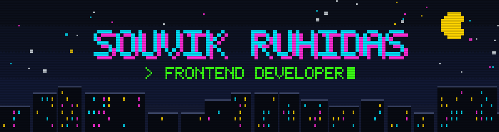
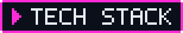
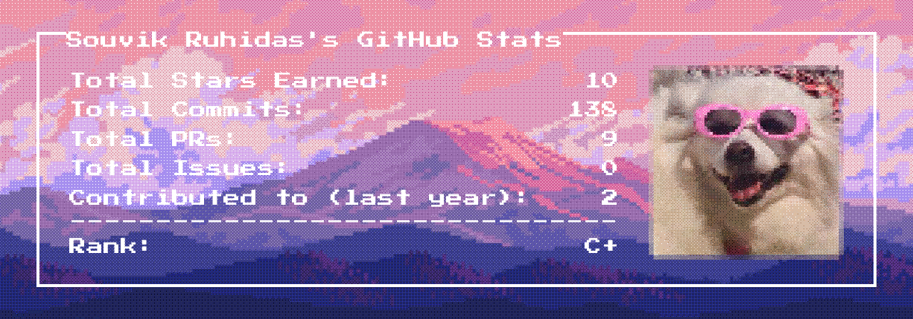
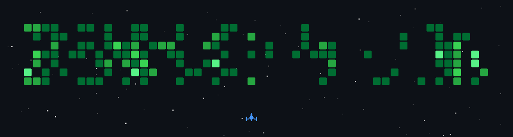
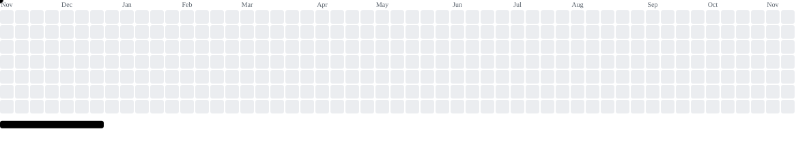
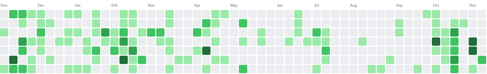
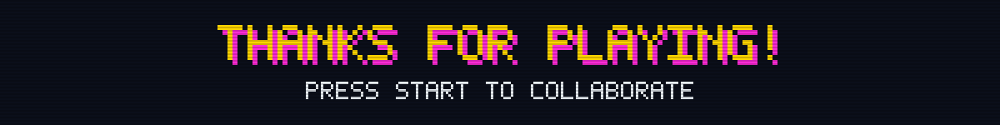

<!-- Pixel assets in Assets/pixel/ are generated by scripts/pixel_art.py.
     Dynamic images (stats, arcade games) are built by .github/workflows/profile-assets.yml
     and published to the `output` branch. -->

<p><a href="https://imakewebsites.in/"></a></p>

<div align="center">

<p></p>

<p><a href="https://imakewebsites.in/"></a></p>

[](https://imakewebsites.in/)
[](https://www.linkedin.com/in/souvik-ruhidas)
[](mailto:souvikdas8426@gmail.com)
[](https://t.me/Kawaiii_Nekoo)

<p></p>

</div>

<p>&nbsp;</p>

<p></p>

<h3></h3>


```ts
const player1 = {
  name:      "Souvik Ruhidas",
  class:     "Frontend Developer",
  guild:     "Computer Science @ SRM University (3rd year)",
  mainQuest: ["Component-driven UIs", "Responsive & accessible design", "Pixel-perfect polish"],
  sideQuest: ["Cross-platform apps with Flutter"],
  equipped:  ["TypeScript", "React", "Next.js", "Tailwind CSS", "shadcn/ui"],
  inventory: ["Node.js", "Express", "Firebase", "Supabase", "Flask", "MongoDB", "PostgreSQL"],
  spawnsOn:  ["Vercel", "Netlify"],
  afk:       ["🎧 music", "🎮 gaming", "🏎️ motorsport"],
};
```

<h3></h3>


<table align="center">
  <tr>
    <td align="center"><code>LANGUAGES</code></td>
    <td></td>
  </tr>
  <tr>
    <td align="center"><code>FRONTEND</code></td>
    <td></td>
  </tr>
  <tr>
    <td align="center"><code>MOBILE</code></td>
    <td></td>
  </tr>
  <tr>
    <td align="center"><code>BACKEND&nbsp;&amp;&nbsp;DATA</code></td>
    <td></td>
  </tr>
  <tr>
    <td align="center"><code>TOOLS&nbsp;&amp;&nbsp;DEPLOY</code></td>
    <td></td>
  </tr>
</table>

<h3></h3>


| | Project | What it does | Stack |
| :-: | :-- | :-- | :-- |
| 🕹️ | [**Corenyth**](https://corenyth.in/) | Cross-platform app built because existing apps didn't cut it, so I wrote my own. |   [](https://corenyth.in/) |
| 💘 | [**BeMine**](https://beeemineee.netlify.app/) | Ask someone a question they can't say no to. Write your lines, pick a vibe and share a private link: every "No" gets more dramatic while "Yes" grows, and you see the result. |      [](https://beeemineee.netlify.app/) |
| 📈 | [**Allexor**](https://allexor.com/) | Website for Allexor, a digital growth agency offering social media, performance marketing, web development and design. |  [](https://allexor.com/) |
| 🤖 | [**HighOnAI**](https://www.highonai.in/) | Website for HighOnAI, a Bengaluru community for people building with AI: demo nights, paper clubs and build sprints. | [](https://www.highonai.in/) |
| 🌐 | [**imakewebsites**](https://imakewebsites.in/) | My portfolio site. |  [](https://imakewebsites.in/) |


<h3></h3>


<div align="center">
  
</div>

<h3></h3>


<p align="center"><sub><code>EVERY GAME BELOW IS PLAYED ON MY REAL CONTRIBUTION GRAPH · REBUILT TWICE A DAY</code></sub></p>

<div align="center">
  
</div>

<br/>

<div align="center">
  <picture>
    <source media="(prefers-color-scheme: dark)" srcset="https://raw.githubusercontent.com/Souvik8426/Souvik8426/output/pacman-contribution-graph-dark.svg"/>
    <source media="(prefers-color-scheme: light)" srcset="https://raw.githubusercontent.com/Souvik8426/Souvik8426/output/pacman-contribution-graph.svg"/>
    
  </picture>
</div>

<br/>

<details>
<summary><b>🪙 INSERT COIN: more games</b></summary>
<br/>


| GALAGA | BREAKOUT |
| :-: | :-: |
| <picture><source media="(prefers-color-scheme: dark)" srcset="https://raw.githubusercontent.com/Souvik8426/Souvik8426/output/galaga-contribution-graph-dark.svg"/></picture> | <picture><source media="(prefers-color-scheme: dark)" srcset="https://raw.githubusercontent.com/Souvik8426/Souvik8426/output/breakout-contribution-graph-dark.svg"/></picture> |
| **TETRIS** | **BOMBERMAN** |
| <picture><source media="(prefers-color-scheme: dark)" srcset="https://raw.githubusercontent.com/Souvik8426/Souvik8426/output/tetris-contribution-graph-dark.svg"/></picture> | <picture><source media="(prefers-color-scheme: dark)" srcset="https://raw.githubusercontent.com/Souvik8426/Souvik8426/output/bomberman-contribution-graph-dark.svg"/></picture> |

<p align="center"><b>SNAKE</b></p>
<div align="center">
  <picture>
    <source media="(prefers-color-scheme: dark)" srcset="https://raw.githubusercontent.com/Souvik8426/Souvik8426/output/github-snake-dark.svg"/>
    
  </picture>
</div>

</details>

<p>&nbsp;</p>

<p></p>

<a href="mailto:souvikdas8426@gmail.com"></a>
